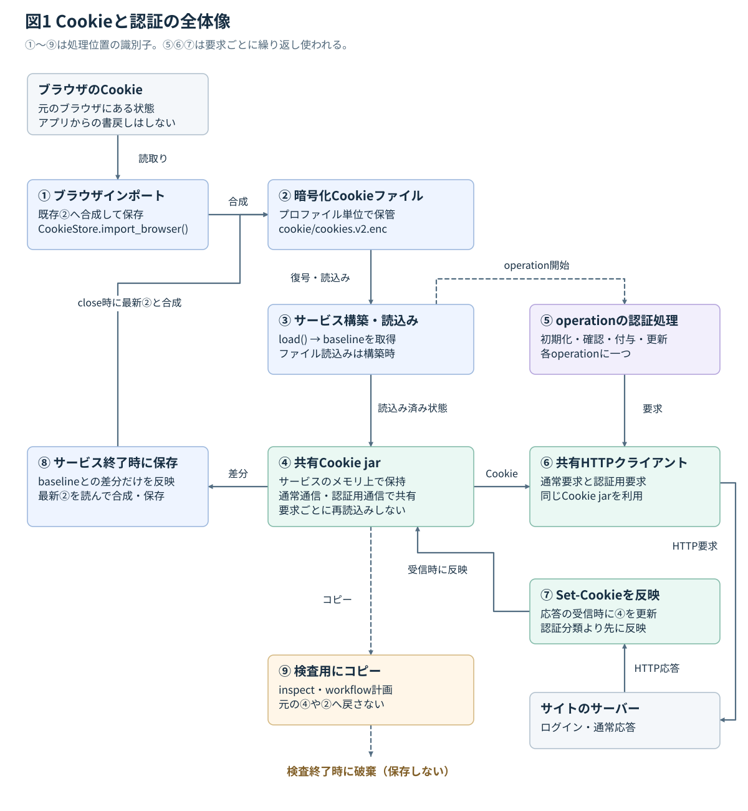
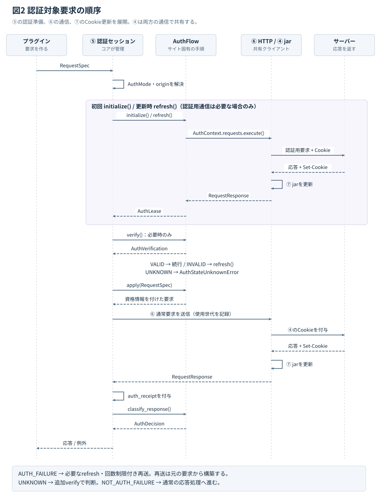
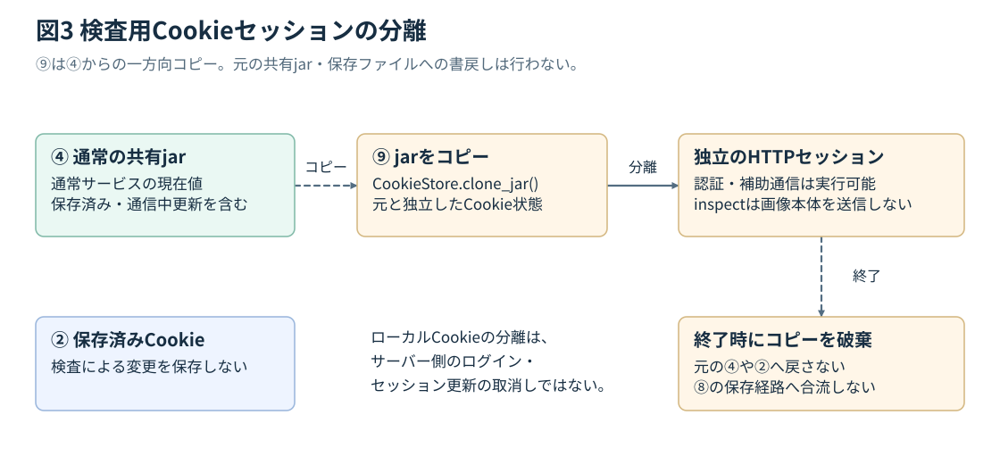

<a id="authentication-and-cookie-flow"></a>

# Cookieと認証の流れ

既存Cookieの読込み、ブラウザからのインポート、認証、通信中の更新、終了時の保存を、実装上の処理位置①〜⑨で説明する。対象はAPI 3の標準的な `RuntimeComposer` / `DownloadService` の経路である。

[HTML版](authentication-and-cookie-flow.html)でも同じ内容を読める。図はSVGとPNGで個別に参照できる。設定値・型・例外の正本は[設定リファレンス](../reference/configuration.md#config-plugin-connections)と[フックリファレンス](../reference/plugin-hooks.md#plugin-authentication)、呼出し順の正本は[実行ライフサイクル](execution-lifecycle.md)である。

図を拡大したい場合はSVG/PNGを個別に開く。HTML版は狭い画面で図・表を横にスクロールできる。

## 最初に区別する3つの状態

| 状態 | 管理単位・管理する場所 | 主な処理位置 |
| --- | --- | --- |
| 保存済みCookie | データルート・プロファイル単位の暗号化ファイル | ①②③⑧ |
| 通信中のCookie | 通常用とサイト別匿名用のCookie jar。メモリ上で更新する | ④⑥⑦ |
| 認証の準備状態・世代・期限 | operation単位のコア認証セッション | ⑤ |

**Cookieを読み込んだこと、サーバーで認証できたこと、Cookieをディスクへ保存したことは別の出来事である。** 保存済みCookieが利用可能かはサーバーの状態にも依存する。認証フローの成功が、直ちにCookieファイルへの保存を意味するわけでもない。

丸付き数字は処理位置の識別子であり、呼出し回数ではない。⑤⑥⑦は要求や再認証に応じて繰り返し使う。①は任意の事前操作、⑨は通常保存から分離した検査用の経路である。

<a id="cookie-overview"></a>

## 全体図：保存から利用、更新、保存まで



図1を個別に開く：[SVG](assets/authentication-cookie-lifecycle.svg) / [PNG](assets/authentication-cookie-lifecycle.png)。図中の矢印はデータや処理の受渡しを示す。図中の「構築時」は現行実装では初回の通常セッション選択時を指す。③は通常セッションを初めて選択した時の遅延読込みである。匿名セッションでは②を読み込まない。図の共有jarは選択セッションごとに区別する。

<a id="phase-legend"></a>

## ①〜⑨の凡例と解説

| 番号 | 図中の位置 | 何をするか・いつ使うか |
| --- | --- | --- |
| ① | ブラウザインポート | ブラウザからCookieを読み、②の既存保存内容へ合成する。通常downloadが自動で行う処理ではない。 |
| ② | プロファイルの暗号化ファイル | 通常セッションを初めて選択した時に読めるCookieの保管場所。通信中のjarそのものではない。 |
| ③ | 通常セッションの初回選択 | ②を読み、④へ渡し、差分保存用baselineを取得する。匿名では読み込まない。 |
| ④ | 共有Cookie jar | 通常要求と認証用要求が共有する、メモリ上のCookie。サービスが所有する。 |
| ⑤ | operationの認証処理 | 接続先・要求モード・確認方針を解決し、初期化・確認・資格情報付与・更新を管理する。 |
| ⑥ | HTTPクライアント | 要求を送信し、応答を受信する。④から送信先に適用可能なCookieを付ける。 |
| ⑦ | 応答による更新 | HTTPクライアントが `Set-Cookie` を④へ反映する。認証応答の分類より前に行われる。 |
| ⑧ | サービス終了時の保存 | baselineと現在の④との差分を、保存直前の最新②へ合成して保存する。 |
| ⑨ | 検査用セッション | ④をコピーして `inspect`・workflow計画に使う。そこでのCookie変更は元の④や②へ戻さない。 |

<a id="phase-1"></a>

### ① ブラウザからのインポート

`cookie browser-import` / `CookieStore.import_browser()` は、ブラウザのCookieを取得し、②の既存内容を読み、合成して暗号化保存する独立した操作である。ブラウザ側への書戻しや継続同期は行わない。ブラウザで再ログインした後の変更を使うには、必要に応じて再インポートする。

明示的なChromeユーザーデータディレクトリを指定した経路は、`Default/Network/Cookies` と `Local State` のスナップショットを使う。指定しない経路は `browser-cookie3` のブラウザ探索を利用する。実ブラウザの対応範囲・実行条件は[Cookie操作](../reference/cli.md#cookie操作とブラウザー対応)と[実行時動作](../reference/runtime-behavior.md#runtime-cookies)を参照する。

インポート先と実行時のデータルート・プロファイルを一致させる。別プロファイルのCookieを自動探索・合流する処理ではない。

<a id="phase-2"></a>

### ② 暗号化Cookieファイル

標準の保存先は次のとおりである。

```text
<storage.data_root>/profiles/<profile>/cookie/cookies.v2.enc
```

マスターキーはOSストアで管理し、Cookie本体は保管庫の暗号化形式で保存する。新ファイルがなければ空のjarから開始する。旧 `cookies.enc` は自動移行・読込みせず、該当時は警告する。壊れた保存内容を、インポートで無条件に上書きして復旧する動作にはしない。

<a id="phase-3"></a>

### ③ 既存Cookieの読込みとbaseline

通常セッションを初めて選択した時に `CookieStore.load()` で②を読み、期限切れCookieを除いて⑥のHTTPクライアントへ渡す。さらに `CookieStore.snapshot()` で初期状態baselineを取得する。匿名セッションは空のjarを作り、②へアクセスしない。

読込みは最初の通常セッション選択時だけ行い、各URLへのアクセスやoperation開始のたびにディスクを読み直さない。同じサービスで複数operationを行う場合は、更新済みの④を引き続き使う。各operationの⑤は別の認証セッションであり、④の共有期間とは異なる。

<a id="phase-4"></a>

### ④ サービス単位の共有Cookie jar

通常のページ・API・画像・補助ファイル要求と、認証フックの専用要求は、選択セッションのjarを共有する。通常用と匿名用は分離し、匿名用は同じプラグイン・サイト・参照設定でコマンド中に共有する。⑥は送信先のdomain・path・secure・有効期限等に従ってCookieを選択する。

`context.get_cookies()` は選択セッションのうち、対象サイトのoriginへ適用可能なCookieのコピーを返す読取りAPIで、送信や保存を行わない。`auth: none` / `AuthMode.NONE` は認証フローを通さない指定であり、jarを無効にする指定ではない。要求に明示した資格情報を全面的に除去する意味もない。

<a id="phase-5"></a>

### ⑤ operation単位の認証処理

コア内部の `OperationAuthSession` は、準備済みか、無効化済みか、資格情報の世代、leaseの期限、最後の追加確認時刻を保持する。Cookieを別途保管する場所ではない。

最初の認証対象要求前に `initialize()` を実行する。既存Cookieが存在しても、この呼出し自体は省略しない。`initialize()` は通信せず既存状態の準備だけを行う。新規ログインはコアがユーザーの `auth_access` を判定した後、`login()` で実行する。`authentication` と `endpoints` は省略できるが、省略は認証全体の無効化ではない。

接続先の `auth: session` と要求の `AuthMode` で認証対象を判定する。認証対象では必要な初期化・確認・更新と `apply()` を行う。フローなしの `AUTO` は通常のHTTP処理で、④のCookieは利用できる。追加originやREQUIREDの条件は[適用範囲](../reference/configuration.md#config-authentication-scope)を参照する。

<a id="phase-6"></a>

### ⑥ 通常通信と認証用通信

通常要求は⑤の認証準備・同期 `apply()` の後、⑥へ進む。認証フックの `AuthContext.requests.execute()` は⑤へ再入しない専用の入口から⑥へ進み、HTTPエラー応答も本文付きで返す。

専用の入口でも④のjar、プール、タイムアウト、通信制限、transport再試行を共有する。ただし自動apply・応答分類・認証確認・認証更新は行わない。送信先はoperationの既定originを含む作者の宣言と、ユーザーのサイトグループの両方に含まれるoriginに限る。initialize中の通信は禁止する。Bearerヘッダー等が必要なら認証フック側が明示する。

<a id="phase-7"></a>

### ⑦ 応答によるCookie更新と認証判定

HTTPXは受信した `Set-Cookie` を④へ反映する。その後、コアは認証対象応答へ `auth_receipt` を付け、`classify_response()` を呼ぶ。Cookie反映のために `response.set_cookies()` を呼んだり、応答オブジェクトをフローへ保持したりする必要はない。

通常の認証不要応答、認証フックの応答、401/403等の失敗応答、リダイレクト途中の応答でもCookie変更は起こり得る。処理や認証の失敗によってCookie変更を自動ロールバックしない。分類・追加確認後もHTTPエラーが残れば、既存の画像URL回復等の通常処理へ進む。

<a id="phase-8"></a>

### ⑧ サービス終了時の差分保存

通常セッションの自動保存タイミングはoperation終了ではなく、`DownloadService.close()` / 非同期コンテキスト終了時である。baselineと現在の④を比較し、このサービスで追加・変更・削除した分を、保存直前に読み直した最新②へ合成する。プロセス間ロック下で合成・保存し、暗号化ファイルを更新する。

匿名セッションは差分保存に含めず、終了時にCookie・取得トークン・フロー参照を破棄する。通常セッションを一度も選択しなければCookie保存処理も実行しない。ダウンロード結果・実行履歴・ログ・更新状態は通常どおり保存する。

通常CLIは終了処理で保存する。ライブラリ利用では `async with service` または `await service.close()` を使う。後始末に到達しない強制終了等では、メモリ上の変更が保存されるとは限らない。通常経路は失敗時にもcloseするため、要求失敗だけを理由にCookie変更を破棄する処理ではない。

`CookieStore.save()` は明示的にjar全体を置換する別APIであり、標準の差分保存とは異なる。有効期限なしのセッションCookieも現行実装では保存対象に含まれるが、ブラウザの終了やサーバー側の失効と同期しているわけではない。

<a id="phase-9"></a>

### ⑨ inspect・workflow計画の分離

現在の④を `clone_jar()` でコピーし、独立したHTTPゲートウェイで検査・計画処理を実行する。コピー内でログイン・確認・Cookie更新を行っても、元の④や②へ戻さない。⑨をcloseしても⑧の保存経路へ合流しない。

`inspect` は画像要求の認証準備・applyとプレビュー構築まで行い、画像本体は送信しない。サイトの検査や認証のための補助HTTPは起こり得る。ローカルCookieの分離は、サーバー側のログイン・token発行・セッション更新の取消しではない。

[検査セッションの分離図](#inspection-diagram)は、認証対象要求の図2に続けて掲載する。

<a id="authentication-sequence"></a>

## 認証対象要求の順序

図2は⑤⑥⑦を展開している。図のinitialize/refresh枠のうち、通信は許可後のlogin/refreshとverifyだけが行う。認証フックの通信は必要な場合だけ行う。保存済みtokenをメモリへ読むだけの `initialize()` も実装できる。`AuthMode.NONE` 等の通常要求は、認証フローの部分を通らず⑥⑦へ進む。



図2を個別に開く：[SVG](assets/authentication-request-sequence.svg) / [PNG](assets/authentication-request-sequence.png)。図中の④は⑥が使う共有jarで、通常通信と認証用通信で分かれていない。

1. 要求のoriginと `AuthMode` を解決する。`context.endpoints` から構築した要求も、絶対URLの要求も同じ解決を通る。
2. 初回は通信なしの `initialize()` で既存状態を準備する。AUTOは準備できなければ認証付与なしで送信する。REQUIRED、認証失敗、期限切れ、明示要求では許可判定後に `login()` / `refresh()` を実行する。
3. 方針や明示操作で必要なら `verify()` を実行する。VALIDなら続行、INVALIDなら更新、UNKNOWNなら専用エラーで停止する。
4. 同期 `apply()` で資格情報を付け、使用する認証世代を記録する。⑥で適用可能な④のCookieを付けて送信する。
5. ⑦でCookieを更新した後、応答にreceiptを付けて分類する。AUTH_FAILUREなら必要な更新・回数制限付き再送へ進む。UNKNOWNなら追加verifyで判断する。

`NOT_AUTH_FAILURE` は認証済みの証明ではなく、その応答を認証更新の根拠にしないという分類である。UNKNOWNの追加確認は、間隔キャッシュだけを理由に省略しない。非冪等要求の認証再送には `retry_non_idempotent=True` が必要で、自動の認証再試行は要求ごとに `network.auth_refresh_attempts` 回までとなる。

初期化・更新・実行中の確認は、同じoperationの並行要求で共有する。一つの待機要求のキャンセルで共有タスクを止めず、operation終了時に残存タスクを回収する。古い世代の失敗応答によって、更新済みの認証を再更新・無効化しない。

<a id="inspection-diagram"></a>

## 検査セッションの分離図



図3を個別に開く：[SVG](assets/authentication-inspection-isolation.svg) / [PNG](assets/authentication-inspection-isolation.png)。④はコピー元、⑨は独立した状態である。検査による変更はコピー内だけに留め、通常の⑧へ合流しない。

<a id="cookie-precedence"></a>

## 読込み・利用・保存の優先順位

「ブラウザ由来」「保存済み」「ログイン由来」という出所による固定の優先順位はない。①で②へ合成し、③で読み込み、⑦で④を更新し、⑧で変更差分を最新②へ合成する。

| 場面 | 現行の動作 |
| --- | --- |
| サービス構築前にブラウザインポート | ③がインポート後の②を読み込む。 |
| サービス構築後に別コマンドでインポート | ②は変わるが、実行中の④へ自動反映しない。次の未読込み通常セッションの初回選択時に読み込む。 |
| サービスが変更していないCookie | ⑧ではそのCookieを差分として書かず、他操作による保存更新を保持する。 |
| ①や⑧で同じCookieを合成 | 識別キーは `(domain, path, name)`。異なるキーのCookieを保持し、同一キーで値が異なれば合成時の入力側の更新を採用する。同値なら長い有効期限を維持する。 |
| 期限切れのインポートCookie | 取り込まない。自然な期限切れを、別プロセスが更新したCookieの無条件削除としては扱わない。 |
| HTTP応答による更新 | ⑦で直ちに④へ反映し、次の要求が利用できる。②への保存は⑧で行う。 |
| ファイルのCookie import / export | 保存済み②を合成・読取りする。実行中の④を自動同期せず、未保存の変更をexportへ自動的に含めない。 |

Cookieキーのdomain/pathは保存属性の文字列を使う。同じ名前でもdomainやpathが異なれば別のCookieである。HTTP要求での送信条件は⑥が判断し、保存時のキー照合とは役割が異なる。

<a id="csrf-cookie-example"></a>

## CSRFサンプルで既存Cookieはどう使われるか

`csrf_login_gallery` の `initialize()` は通信せず `AuthLease()` を返し、既存Cookieを先に試す。認証失敗が判明した時はコアがログイン許可を判定し、`login()` / `refresh()` がCSRF付きログインを実行する。匿名モードでもこの手順は同じだが、最初のCookieは空で終了時に保存しない。

```text
③ 保存済みCookieを読み、④へ保持
⑤ initialize() → 既存Cookieで通常要求
⑤ 認証失敗 → 許可判定 → login() / refresh()
  ⑥ GET /login       : 適用可能な既存Cookieを送信
  ⑦ 応答Cookieを保存 : 事前セッションCookie等
  ⑥ POST /session    : 資格情報・CSRF token・適用可能なCookieを送信
  ⑦ 応答Cookieを保存 : 認証済みCookie等
⑤ AuthLease()を受理  : コアの世代・無効状態・期限情報を更新
⑥ 後続の通常要求     : 更新済み④のCookieを送信
⑧ サービス終了      : 変更差分を②へ保存
```

`session = await auth_context.requests.execute(...)` の `session` は `RequestResponse` であり、セッション管理オブジェクトではない。サンプルは `session.status` を確認している。⑦でjarが更新されるため、その応答をフロー内に保持し続ける必要はない。サーバーが既存Cookieに対応するセッションを認証済みにする方式なら、新しいCookieを発行しない場合もある。

`AuthLease()` はCookieを作成・保存せず、サーバーのログイン成功も自動検証しない。サンプルはPOSTのHTTPステータスだけを確認するため、200の失敗フォーム等は実サイトに合う判定で補う。Bearer tokenをJSON本文で受け取る方式なら、本文解析・token保持・同期 `apply()` が必要であり、Cookie共有だけでは対応できない。

**CookieのExpiresと `AuthLease` の期限は別管理である。** コアがCookie期限を自動的にleaseへ転記することはない。プラグインが期限情報を返さなければleaseは期限不明で、必要な応答分類・追加確認によって更新する。

<a id="new-authentication-api"></a>

## 今回追加・再設計した公開APIと図の位置

次の表は認証再設計の対象を列挙する。`auth_flow()` は生成フックを維持し、返すフローの契約を変更した。既存の `RequestSpec` / `RequestResponse` / `PluginExecutionContext` には認証関連の項目を追加・置換している。

### フロー・コンテキスト・要求操作

| API | 位置 | 役割 |
| --- | --- | --- |
| `auth_flow(context) -> AuthFlow または None` | ⑤の構成時 | operationで使うフローを生成する。Noneなら認証フローを使わない。 |
| `AuthFlow` / `BaseAuthFlow` | ⑤ | 認証手順の契約と既定実装。既定initializeはNone、既定applyは要求をそのまま返す。 |
| `initialize(auth_context) -> AuthLease または None` | ⑤初回 | 通信なしで保存tokenの読込み・Cookie再利用の準備を行う。 |
| `login(auth_context) -> AuthLease` | ⑤許可後 | 新規ログインを行う。 |
| `apply(request) -> RequestSpec` | ⑤→⑥ | 資格情報を同期付与する。通信せず、origin・authモードを変更しない。 |
| `classify_response(request, response) -> AuthDecision` | ⑦の後 | 通信なしで応答を分類する。既定は401がAUTH_FAILURE、403がUNKNOWN、その他がNOT_AUTH_FAILURE。 |
| `verify(auth_context) -> AuthVerification` | ⑤・⑦の後 | 必要なら追加通信で状態確認する。既定はUNKNOWNなので、確認を有効にするサイトは実装する。 |
| `refresh(auth_context) -> AuthLease` | ⑤・認証再試行前 | 再ログイン・token更新を行う。既定はloginへの委譲。 |
| `AuthContext` | ⑤のフック内 | 固有config、サイトに束縛したcredentials、endpoints、専用requestsを提供する。 |
| `AuthContext.requests.execute()` | ⑤→⑥ | 再入しない認証用通信。④を共有し、自動の認証付与・分類・確認・更新を行わない。 |
| `PluginExecutionContext.auth: AuthPort` | ⑤への入口 | 明示的な準備・確認・無効化を提供する。 |
| `await context.auth.ensure_ready(check=False)` | ⑤ | 必要な初期化・期限更新・無効化後の更新。check=Trueなら追加確認も要求する。 |
| `await context.auth.request_login(reason)` | ⑤ | 許可判定後にログインする。拒否はFalse、成功はTrue、失敗は例外。 |
| `context.auth.invalidate(response)` | ⑦の後→次回⑤ | 同一operationの現在世代を無効化する。Cookie削除や即時ログインは行わない。古い世代は無視する。 |
| `Endpoint` / `context.endpoints` | ⑤より前の要求構築 | originを名前で参照する。AuthContextにも提供し、operationを自動的に用意する。 |
| `Endpoint.request(path, **kwargs)` | ⑤より前の要求構築 | 通信せずRequestSpecを構築する。画像要求フックでも利用できる。 |
| `RequestSpec.auth` / `AuthMode` | ⑤入口 | AUTOは接続先に従い、NONEは認証フローを通さず、REQUIREDはフローと認証対象originを必須にする。 |

`initialize()` / `login()` / `verify()` / `refresh()` / `ensure_ready()` / `request_login()` は非同期、`apply()` / `classify_response()` / `invalidate()` / `Endpoint.request()` は同期である。`.request()` を呼んだだけでは⑥へ進まない。通常の実行では `context.requests.execute()` へ渡すか、画像要求フックから返す。

### 値型・応答情報

| API | 位置 | 意味 |
| --- | --- | --- |
| `AuthLease(expires_in_seconds=None)` | ⑤ | 利用可能な状態と任意の残存期限。期限は正の有限秒数、Noneなら不明。Cookieそのものは保持しない。 |
| `AuthDecision` | ⑦の後 | AUTH_FAILURE / NOT_AUTH_FAILURE / UNKNOWN。通常応答の分類。 |
| `AuthVerification` / `AuthStatus` | ⑤・⑦の後 | VALID / INVALID / UNKNOWNと任意のlease。新しいleaseを返せるのはVALIDだけで、省略時は既存期限を維持する。 |
| `AuthReceipt` | ⑤送信準備→⑦ | operationと使用した認証世代を識別する不透明な値。資格情報は含まない。 |
| `RequestResponse.auth_receipt` | ⑦の応答 | invalidateが所属・世代を検証するための情報。別operationやreceiptなしの応答は拒否する。 |

### 共通設定型

次の型は `image_downloader.config` から公開する。⑤の対象解決・確認頻度・期限更新に使い、④の読込み頻度や⑧の保存頻度は変更しない。

| 型・設定 | ⑤での役割 |
| --- | --- |
| `AuthenticationPolicy` / `authentication` | 共通のverify_on_start・verify_before_request・verify_interval_seconds・refresh_skew_seconds。 |
| `EndpointSettings` / `endpoints` | originとauth: session / noneの宣言。 |
| `EndpointVerification` / `verification` | originごとのbefore_request・interval_secondsの部分上書き。 |
| `PluginConnections` | 作者設定と利用者設定をマージした接続先・認証方針の検証。 |
| `PluginAuthAccess` / `SiteAuthAccess` | 作者設定と分離したユーザー専用の資格情報提供・ログイン許可・セッション保存方針。 |

共通の `verify_before_request` と接続先の `verification.before_request` は同じverifyの呼出しを制御し、後者をそのoriginの上書きとして使う。省略すれば継承する。before_requestのfalseだけでは継承した間隔は止まらず、間隔を無効にするにはinterval_secondsにnullを明示する。

確認時刻と認証世代はoperation内で共有する。開始時はoperationの初回認証準備時であり、アプリ起動時ではない。間隔確認と期限前更新は要求時に判定し、バックグラウンドの定期通信をしない。現行の毎要求確認は認証準備時の単位で、低層transport再試行・redirect各hopではverifyを呼び直さない。

### 追加した例外と内部実装

| API | 発生位置・理由 |
| --- | --- |
| `AuthScopeError` | ⑤の対象解決、⑤→⑥の送信先検証、応答receipt検証。未宣言origin・REQUIREDの条件不成立・別operationの応答等。 |
| `AuthReentryError` | ⑤の認証フックから通常のcontext.requests / context.authへ再入した場合。ロック待ちに入る前に拒否する。 |
| `AuthStateUnknownError` | ⑤のverifyでも状態を判断できない場合。 |

これら3例外はworkflowの自動再試行対象外である。⑤の内部実装が `OperationAuthSession` で、プラグインが直接構築する公開APIではない。API番号3は維持したが、旧is_auth_failure、refresh(failed, response)、auth_required、allowed_originsとの互換層はない。[移行ガイド](../how-to/authentication-migration.md)を参照する。

<a id="existing-cookie-api"></a>

## 既存のCookie APIとの接続

この表は今回新設したAPIの一覧ではなく、図の保管・通信側に接続する既存APIを示す。

| API | 位置・役割 |
| --- | --- |
| `CookieStore.import_browser()` | ①→②。ブラウザCookieを保存内容へ合成する。 |
| `CookieStore.load()` | ②→③。暗号化Cookieを復号してjarを得る。 |
| `CookieStore.snapshot()` | ③。差分比較用baselineを得る。 |
| `CookieStore.persist_delta()` | ⑧→②。実行中の変更分を最新保存内容へ合成する。 |
| `CookieStore.save()` | 明示的にjar全体を置換する。標準終了時の差分保存とは異なる。 |
| `CookieStore.clone_jar()` | ④→⑨。検査用の独立jarを作る。 |
| `RequestGateway` / `RequestPort` | ⑥。共有HTTPクライアントと要求送信の入口。認証用入口も同じtransportを利用する。 |
| `context.get_cookies()` / `CookieProvider` | ④の現在値をコピーして読む。更新・保存・送信を行わない。 |
| `RequestResponse.set_cookies()` | ⑦の最終応答自身のSet-Cookieを解析する。jarを更新しない。 |
| `DownloadService.close()` | ⑧。通常構成でCookie差分を保存してリソースを閉じる。 |

独自に `RequestGateway` だけを構築した場合、②からの読込み・⑧の自動保存まで付いてくるわけではない。この文書の自動処理は標準のサービス構成を前提にしている。

<a id="implementation-references"></a>

## 実装・関連ドキュメント

| 確認対象 | 参照先 |
| --- | --- |
| ①②③⑧の保管・合成規則 | [CookieStore](../../../src/image_downloader/storage/cookies.py)、[Cookieの実行時仕様](../reference/runtime-behavior.md#runtime-cookies) |
| ③の構築と⑧の終了時保存 | [RuntimeComposer](../../../src/image_downloader/application/composer.py)、[DownloadService](../../../src/image_downloader/application/service.py) |
| ④⑥⑦の共有HTTPクライアント | [RequestGateway](../../../src/image_downloader/transport/gateway.py) |
| ⑤の認証状態と専用通信 | [OperationAuthSession](../../../src/image_downloader/transport/auth.py)、[operationの要求経路](../../../src/image_downloader/transport/operation.py) |
| ⑨の検査・計画 | [InspectionExecutor](../../../src/image_downloader/application/inspection.py)、[workflow計画](../../../src/image_downloader/application/workflow_plan.py) |
| Cookieログインの例 | [CSRFサンプル](../../../plugin-sources/csrf-login-gallery/csrf_login_gallery.py)、[移行ガイド](../how-to/authentication-migration.md#cookie-session-refresh) |
| 設定とAPI契約 | [設定リファレンス](../reference/configuration.md#config-plugin-connections)、[フックリファレンス](../reference/plugin-hooks.md#plugin-authentication)、[公開シグネチャ](../reference/api-signatures.md) |

HTML版の本文と図は外部通信なしで表示できる。SVG/PNGの個別参照リンクを含めて配布する場合は、この文書とHTMLに加えて同じディレクトリの `assets` 内の図も同梱する。

[サイト別の認証許可と匿名セッション](../how-to/auth-access-and-ephemeral-sessions.md)
