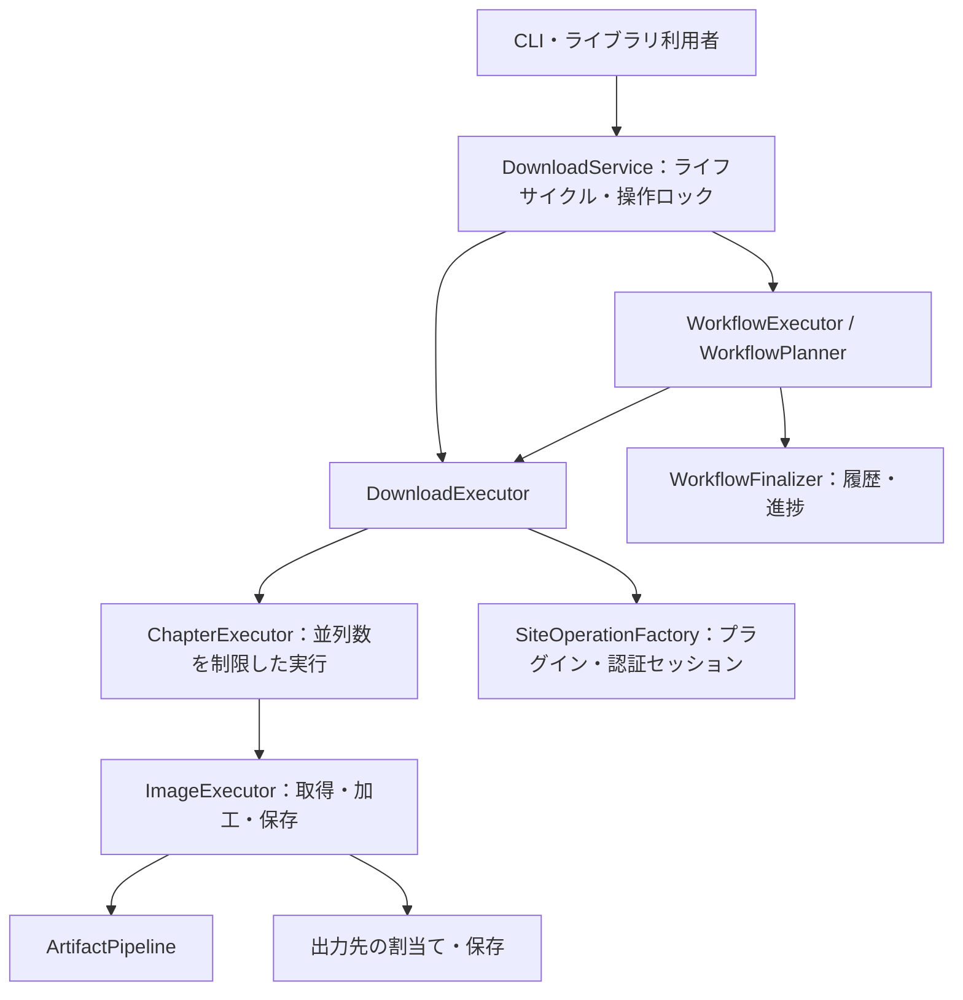

# アーキテクチャと非公開の実装境界

安定APIは、パッケージ直下と文書化された6つのファサードだけです。`configuration.*`はYAMLの解決と検証、`storage.*`は管理ルートの安全性とプロセス間の排他、`transport.gateway`はHTTP通信、`transport.operation`は認証セッションを担当します。`plugins.*`は発見・検証・ロード・選択、`media.*`は画像データの加工、`application.*`は依存の構築と操作の実行、`observability.*`は診断を受け持ちます。

`RuntimeComposer`は、ファイルシステム、状態、イベント、通知、Cookie、HTTP、画像処理、ログの依存を構築します。`DownloadService`は、それらのライフサイクルを管理します。サービス内部の直接構築や`service`の実装属性への依存はサポートしません。高度な依存構築に使う`_RuntimeDependencies`は、意図的に安定APIとして公開するDTOです。

公開操作は、操作別の不変なリクエストDTOを受け取ります。`DownloadService`は開閉状態と操作間の排他を、`SiteOperationFactory`はプラグイン操作の準備と後始末を担当します。ダウンロード・章・画像・検査・更新確認の実行器は、各段階の処理を担当します。ワークフローの実行と計画処理には`WorkflowRuntime`で依存を明示的に渡し、公開サービスをインポートしません。`WorkflowFinalizer`は履歴と進捗を確定してから、型付きのワークフロー例外で`.result`と`.cause`を公開します。キャンセル用の例外は、引き続き`asyncio.CancelledError`を継承します。

CLIの検証処理は不変の`PreparedCommand`を生成します。入力は`DownloadArguments`、`WorkflowArguments`などのコマンド別dataclassへ複製し、位置引数の列もタプルへ変換します。実行側は元の`argparse.Namespace`や構文解析用の属性を保持しません。設定選択だけを共通の基底型で共有し、コマンド固有の項目は各型に定義します。Cookieの旧オプション形式も、この境界で通常の操作名・対象へ正規化します。

共通の構文規則とエラー表示処理は、依存関係上、コマンド振り分け処理より下位に置きます。実行時のインポート循環の検査には関数内のインポートも含め、`TYPE_CHECKING`分岐は除外します。プラグインカタログの保存、署名・ファイルツリーの検証、設定の正規化と由来追跡、通知の整形・配送、HTTP認証、画像要求の回復は別々のモジュールに配置します。検証時のファイル種別判定・安全な読取りはstorage側へ集約し、applicationから`FileSystem`のprivateメソッドは呼びません。原子的な書き込みとOS固有のlockの安全性アルゴリズムは維持します。

`SiteSelection`は、選択したプラグインを操作へ引き渡すまで所有します。ロック取得・状態検証・周回準備に失敗しても後始末を行い、`SiteOperation`への引渡し後はそちらが一度だけ後始末を担当します。検査・計画の一時HTTPセッションは、主処理が失敗した場合に主例外を維持し、終了失敗を固定文言の警告へ記録します。診断の確定中にキャンセルされても、Pythonログの収集解除は呼出し元のコンテキストで必ず実行します。

サービスは終了タスクを一度だけ作成し、`application.shutdown`でリソースを順番に閉じます。終了タスクは操作ロックを保持し、待機側のキャンセルは`settle_task`で回収します。終了失敗は子タスクから重大例外を直接送出せず、結果として呼出し側へ渡します。`close_service`は主原因がある場合にそれを保持する共通の境界です。

ログ終了も共通の終了順序の最後に置きます。ログ固有の非公開helperは通常例外だけを固定の診断警告へ変換します。ログの通常終了例外は、最初の通常終了失敗を返す規則の対象外であり、結果・終了コード・履歴を変更しません。キャンセル・重大例外は抑制せず、他リソースと同じ所有者へ失敗情報として渡します。

並列ジョブと確定待ち処理は、タスクを作る前に`capture_result`で処理を包みます。`SystemExit`や`KeyboardInterrupt`が子タスクから漏れると、呼出し側で捕捉する前にイベントループが停止するためです。元の例外は`TaskSettlement.error`で受け渡し、開始済みの処理を回収した後に所有者が再送出します。`settle_operation`は待機側のキャンセルと処理側の失敗を別々に保持し、保存では処理の失敗、履歴ではキャンセルを優先する既存の規則を維持します。並列実行はfactoryの同期例外も同じ境界で捕捉し、未開始の処理を止めます。

`WorkflowState.read_feeds()`は、短いworkflowロックの下で不変な`WorkflowFeedSnapshot`のタプルを渡すcontext managerです。そのコンテキスト内で履歴を読むことで、workflowロック→履歴ロックの順序を保ちます。フィードロックは取得しません。applicationは保存用辞書や非公開の読取関数を使いません。`source_key()`は既存のUTF-8 URLのSHA-256を維持し、名前長の調整は`FileSystem.shorten_component()`を通じて既存アルゴリズムを利用します。

テストの背景タスクはsupportの`managed_task()`で、作成直後から所有します。開始待ちは`wait_until_started()`で処理の早期終了と区別し、失敗した場合もサービス終了より先にタスクをキャンセル・回収します。保護された書き込みをEventで止めるテストでは、回収前に`finally`でEventを解放します。

スレッドからの開始通知は`loop.call_soon_threadsafe()`でasyncioのEventへ渡し、開始待ちのためだけに別のスレッドを残しません。重大例外の回帰テストはサブプロセスで実行し、例外がイベントループの外へ漏れる不具合が再発しても、pytest自体の中断ではなくテスト失敗として記録します。

プラグインモジュールは、サービスごとに所有する分離された名前空間へロードします。`PluginRecord`は不変のメタデータのスナップショットであり、インポート済みモジュールのキャッシュではありません。loader・runtime・serviceの終了時には、その名前空間を解放し、別のサービスインスタンスに影響を与えません。ここで説明する内容は保守上の構造であり、内部モジュールのインポートパスの互換性を保証するものではありません。

## Workflow画像比較の保守方針

当面はworkflowの画像照合・再取得の動作仕様を維持し、比較条件と確定済み結果を保持する理由を
読み取りやすくする整理を優先する。現行の条件表は[実行時動作](../reference/runtime-behavior.md#workflow-retry-rounds)、
利用者向けの説明は[FAQ](../how-to/faq.md#workflow-retry-faq)を正とする。

`application.workflow_retry.ImageLedger.begin()`は、同一pluginで、一意に照合できるchapter／画像について、
前回と今回の`ImageResource`全体をdataclassの等価比較で比較する。この一致と結果の再試行可否によって、
成功・skipおよび再試行対象外の失敗を保持する。これは画像本体の厳密な変更検知ではない。

| 条件を維持する観点 | 理由 |
| --- | --- |
| 成功成果物の保護 | 部分失敗の回復時に変更のない成功画像を再取得・再保存せず、`rename`の重複保存や`error`の保存衝突を抑える |
| 加工結果の正しさ | `metadata`や`index`はpluginの加工入力になり得るため、変化を無視しない |
| 取得条件の追随 | URL／locatorや`headers`／`referer`は要求・取得結果へ影響し得るため、変化を無視しない |
| 保存条件・名前の追随 | `save_options`と`original_filename`の変化も再取得対象とし、更新された指定で通常処理する。ただし保存結果は既存ファイル方針に従う |
| 既存pluginとの互換性 | 画像単位のrevision／hashを返さないpluginでも、画像情報が同じ成功結果を保持できる |

全体等価比較は短く書ける一方、`ImageResource`へフィールドを追加すると、dataclassの既定の
`compare=True`でそのフィールドも比較に参加する。結果として、明示的な判定分岐を追加しなくても、
その値の変化が再取得条件となる。DTOの拡張はworkflowの動作への影響もレビューする必要がある。

- フィールド追加時は、識別・取得・加工・保存のどこに影響する情報かを確認し、比較へ参加する意図を明記する。
- 比較対象の追加・除外は、公開動作への影響を確認し、条件表・FAQと必要な挙動テストを更新する。
- 比較を目的の分かる関数へ切り出す場合は、既存の全フィールド比較、曖昧な識別の扱い、結果の再試行可否を維持する。判定の整理に仕様変更を混ぜない。
- 保存だけに関わる条件を除外する案でも、pluginがその情報を加工入力として使っていないかを先に確認する。

保存条件・名前の比較除外や、比較可能な画像revision／hashの一致によるURL比較の省略は将来の検討対象であり、
現在の動作ではない。変更する場合は、それぞれ独立した仕様変更として扱う。

現行比較を維持するだけで加工結果の正しさが保証されるわけではない。manifest／chapterの情報や、
実要求・responseから得るrequest-time情報など、加工へ渡るすべての入力をこの画像比較で扱っているわけではない。
比較対象外の入力変更、同じ画像情報のままの本体変更、保存済み成果物の破損・削除を確認するには、
別途検証・設計が必要である。現行の制限は[実行時動作](../reference/runtime-behavior.md#workflow-retry-rounds)を参照する。
